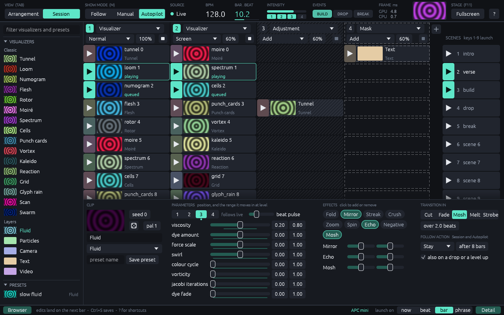
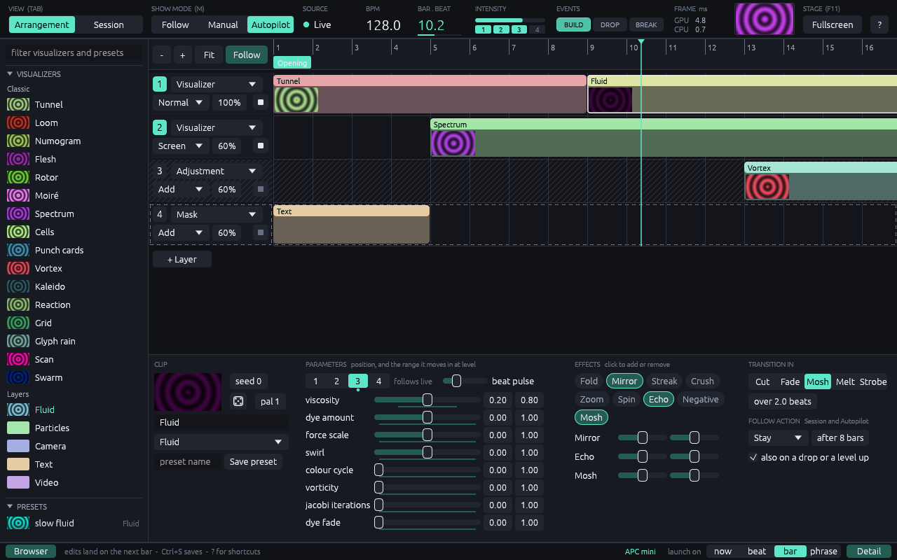
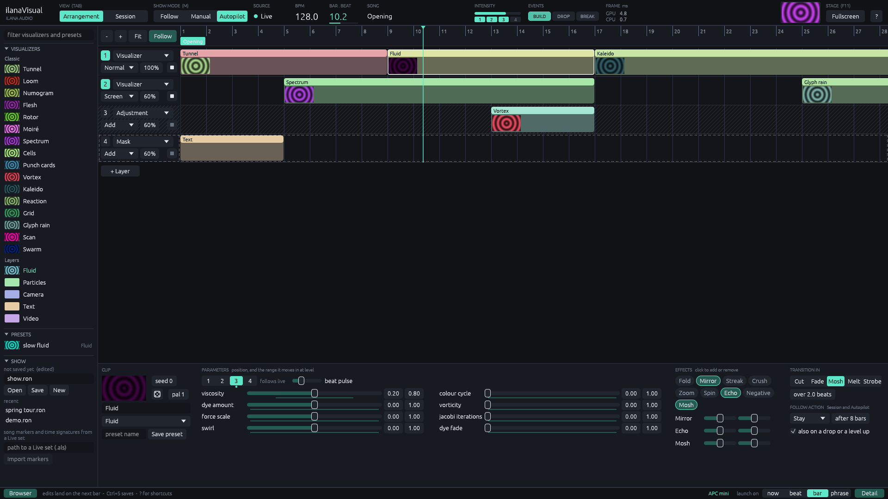
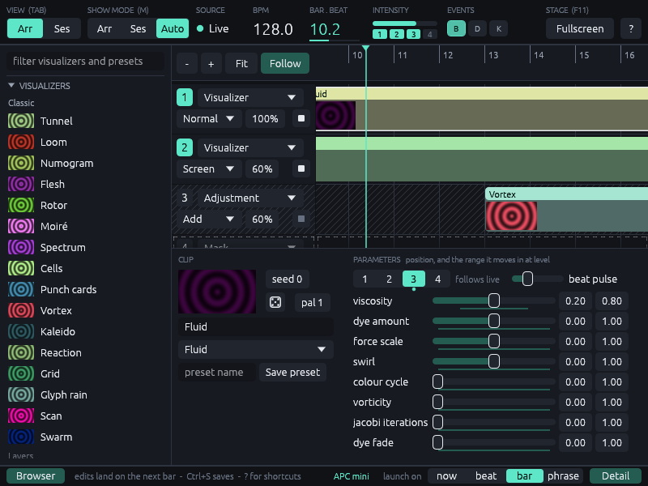
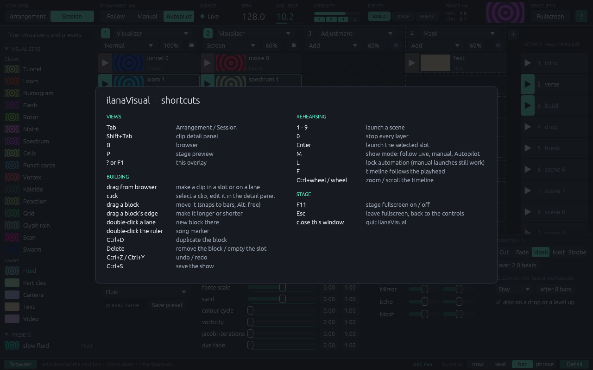

# ilanaVisual: the control window

The control window is for building and rehearsing a show. During a set it is minimised and costs
nothing; the show runs by itself. This page is the design: what is where, how a show is built
with it, and why it is this way. The code is `native/crates/mosh-app/src/editor/`.

The pictures here are not photographs of a window. `tests/ui.rs` builds the real views headless
and rasterises egui's triangles on the CPU (`cargo test -p mosh-app --test ui screenshots`), with
a made-up show and made-up thumbnails. Nothing on this page has been seen in a real window yet.

## Layout

    +----------------------------------------------------------------------------------+
    | top bar: view | show mode | source | BPM | bar.beat | song | intensity | events  |
    |                                                    frame ms | preview | stage | ? |
    +-----------+----------------------------------------------------------------------+
    | browser   |  ARRANGEMENT (timeline)  or  SESSION (clip grid)        Tab toggles  |
    |  (B)      |                                                                      |
    |           +----------------------------------------------------------------------+
    |           |  detail: the selected clip                              Shift+Tab    |
    +-----------+----------------------------------------------------------------------+
    | Browser | last message / hint                  APC | launch on: now beat bar phrase | Detail |
    +----------------------------------------------------------------------------------+

**Two main views, `Tab` toggles**, as in Live.

- **Arrangement** is the timeline that follows Live's playhead: a ruler in bars, song markers,
  one lane per layer, clips as coloured blocks with a picture of what they show. It keeps what
  made the web version easy: click a block and it is in the detail panel. Blocks are dragged to
  move and dragged by an edge to resize, snapping to bar lines through the time-signature map
  (Alt places freely). A block dropped on another trims, splits or replaces it, as in Live.
  Nothing is edited while the mouse is down: the drag is a ghost, the edit is one command on
  release, and one undo step.
- **Session** is the clip grid: columns are layers, rows are scenes. The triangle at the left of
  a slot launches it, the rest of the slot selects it. The scene column launches a row (keys
  `1`-`9`), the square in a layer's header stops it, `0` stops everything.

**The top bar** answers, left to right, the questions of a rehearsal: which view, what drives
the show, is Live connected, how fast, where, which song, how loud does the analysis think it
is (the meter is the continuous intensity, the four pips the level 1-4), did it just see a build,
a drop or a breakdown (the lamps light on the event and fade over 1.5 s), is the frame inside
its budget (the numbers turn yellow over 6 ms GPU or 2 ms CPU). A narrow window drops the brand,
the song, the frame times and the preview, in that order (`top_bar_plan`), and shortens labels;
it never overlaps.

**The browser** (left, `B`) holds what a show is built from, grouped as
`mosh_visuals::catalog` groups it, so a scene another lane adds appears with no UI change. Drag
a visualizer or a preset onto a session slot or an arrangement lane to make a clip; double-click
to use it for the selected clip. Below: the show's file (new, open, save, recent) and the
Live-set import.

**The detail panel** (bottom, `Shift+Tab`) is the selected clip, left to right in the order a
look is built: picture, name, visualizer, seed (the die rolls one), palette, the media source
for the visualizers that have one (a video path, a camera, words); the eight parameters by name
with the range each moves in at the chosen intensity level and that level's beat pulse; effect
chips with amount and parameter; transition in and follow action.

**A layer's header** is the same in both views: number (lit while the layer plays), kind
(Visualizer / Video / Adjustment / Mask), blend, opacity, stop. An adjustment layer is hatched
(it lies over what is below), a mask layer has a dashed outline (a stencil), in the header, the
slots and the lane.

## Decisions, and why

- **View and show mode are two controls with different words.** The view is what you look at
  (Arrangement / Session). The mode is what drives the stage, and it is labelled by what it does:
  *Follow* (the timeline follows Live), *Manual* (clips launched by hand), *Autopilot*. Two
  switches both saying "Arrangement / Session" next to each other is the mistake this avoids;
  the hover text names the mode in the project's terms.
- **One accent colour means "live".** Playing slots, the playhead, lit lamps, the level meter,
  the current song marker. A queued launch blinks in it until its bar line; a queued stop blinks
  red. Clip colours are data: a hue per visualizer, the same in the browser, the grid and the
  timeline. Text is at least 7:1 on every surface, dim text and the accent at least 4.5:1
  (tested).
- **A slider of a clip that is on stage moves the stage at once.** The project still lands on
  the next bar (the rule that keeps a half-edit off the stage), but the parameter or the opacity
  being dragged is also sent as a live control event, so tweaking feels like the web version.
- **Undo is one step per gesture** (`Ctrl+Z` / `Ctrl+Y`): a whole slider drag, a block move.
  Launching, stopping and the show mode are the running show's state, not edits.
- **The keyboard is Live's where Live has one** (`Tab`, `Shift+Tab`, `Ctrl+D`, `Delete`), and
  the top row is the scene column. `?` shows all of it.
- **The window never hides.** On one screen the stage is an ordinary window beside the controls
  (64% / the rest, 16:9). `F11` in either window takes the stage fullscreen and back; `Esc` on
  the stage leaves fullscreen and brings the controls to the front. With a second monitor the
  stage is fullscreen there and the controls are on the laptop. `Esc` no longer quits: closing
  the control window does.
- **The preview is small, slow and often off, on purpose.** Each capture waits about 5.5 ms on
  the render thread (see `preview.rs` for why and for what would fix it), so it is 96 px wide,
  4 fps, on only when the stage is on another monitor (click it or press `P` to change that),
  and never runs while the control window is minimised.

## Shortcuts

| key | does |
| --- | --- |
| `Tab` | Arrangement / Session |
| `Shift+Tab` | detail panel |
| `B` | browser |
| `P` | stage preview |
| `?` or `F1` | shortcuts overlay |
| `1`-`9`, `0` | launch a scene, stop every layer |
| `Enter` | launch the selected slot |
| `M` | show mode: Follow, Manual, Autopilot |
| `L` | lock automation |
| `F` | timeline follows the playhead |
| `Ctrl+D`, `Delete` | duplicate / remove the selected block (or empty the slot) |
| `Ctrl+Z`, `Ctrl+Y` | undo, redo |
| `Ctrl+S` | save |
| `F11`, `Esc` (on the stage) | stage fullscreen on/off, back to the controls |

## More pictures

